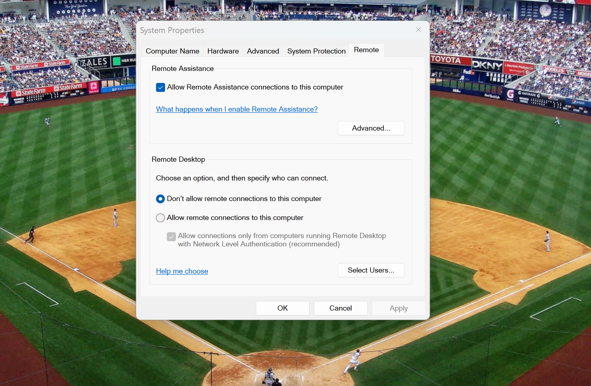
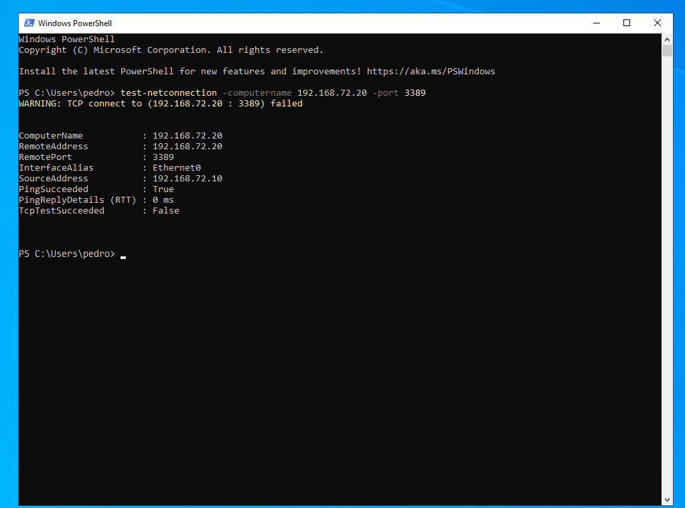
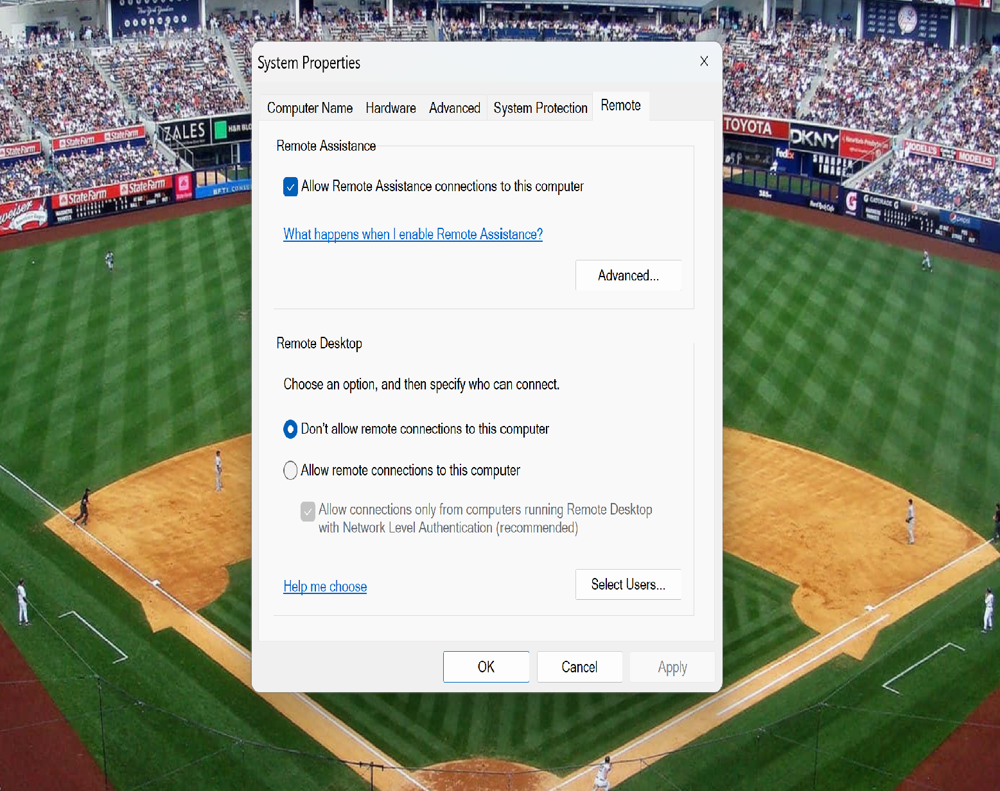
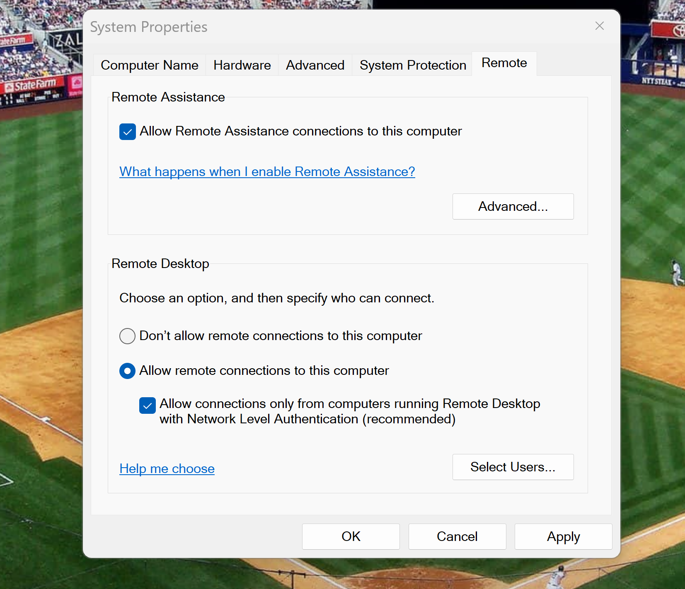
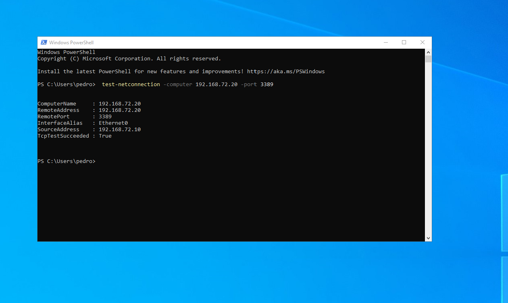

# TechNova IT Support — Ticket #1046
## Windows 11 Remote Desktop (RDP) Troubleshooting

### Project Overview

This hands-on IT support lab simulates a Remote Desktop connectivity incident at TechNova, a fictional company.

An IT technician was unable to remotely access an employee's Windows 11 workstation. The objective was to investigate the connection failure, identify the root cause, restore remote access, and verify that the issue was resolved.

**Ticket ID:** #1046  
**Category:** Remote Access / Network Troubleshooting  
**Priority:** Medium  
**Status:** Resolved

---

## Lab Environment

| Component | Configuration |
|---|---|
| Virtualization | VMware Workstation |
| Technician Machine | DC01 — Windows Server 2022 |
| Employee Workstation | PC01 — Windows 11 Pro |
| DC01 IP Address | 192.168.72.10 |
| PC01 IP Address | 192.168.72.20 |
| Network Configuration | VMware NAT |
| Remote Access Protocol | RDP |
| TCP Port | 3389 |

---

## 1. Initial Investigation — Remote Desktop Disabled

The technician inspected the Remote Desktop configuration on PC01 using `SystemPropertiesRemote`.

The initial investigation revealed that incoming Remote Desktop connections were disabled.

This configuration prevented the workstation from accepting RDP connections.

**Finding:** Remote Desktop was disabled on PC01.

---

## 2. Reproducing the Connection Failure

From DC01, the technician launched Remote Desktop Connection using:

`mstsc`

The technician attempted to connect to PC01 using its IP address:

`192.168.72.20`

Windows displayed an error indicating that Remote Desktop could not connect to the remote computer.

**Finding:** The RDP connection failed even though the computers were connected to the same virtual network.

---

## 3. Diagnosing TCP Port 3389 with PowerShell

The technician used PowerShell on DC01 to test connectivity to the RDP service on PC01.

**Command:**

    Test-NetConnection -ComputerName 192.168.72.20 -Port 3389

**Results:**

- PingSucceeded: True
- TcpTestSucceeded: False

The successful ping confirmed that PC01 was reachable through ICMP.

However, the failed TCP test indicated that a connection to port 3389 could not be established.

Combined with the initial Remote Desktop configuration, this supported the diagnosis that RDP was disabled on the destination workstation.

**Finding:** Network reachability was available, but the RDP service was not accepting connections.

---

## 4. Implementing the Solution

The technician accessed PC01 and opened the Remote Desktop configuration.

**Tool used:**

`SystemPropertiesRemote`

The following configuration was applied:

- Enabled incoming Remote Desktop connections.
- Kept Network Level Authentication (NLA) enabled.
- Applied the configuration changes.

Network Level Authentication provides an additional authentication requirement before establishing a full remote desktop session.

**Action Taken:** Remote Desktop was successfully enabled on PC01.

---

## 5. Verifying TCP Port Connectivity

After enabling Remote Desktop, the technician returned to DC01 and repeated the PowerShell connectivity test.

**Command:**

    Test-NetConnection -ComputerName 192.168.72.20 -Port 3389

**New Results:**

- TcpTestSucceeded: True

This confirmed that DC01 could now establish a TCP connection to port 3389 on PC01.

**Verification:** TCP port 3389 was reachable after the configuration change.

---

## 6. Successful Remote Desktop Connection

The technician launched Remote Desktop Connection again from DC01.

**Command:**

`mstsc`

**Destination:**

`192.168.72.20`

The technician authenticated using an authorized account and successfully accessed the Windows 11 desktop remotely.

A certificate trust warning was reviewed in the isolated lab environment before continuing.

**Final Verification:** Remote Desktop access to PC01 was successfully restored.

---

## Root Cause Analysis

**Root Cause:** Remote Desktop connections were disabled on PC01.

Although the workstation was reachable over the network, the RDP service was not accepting incoming connections.

The technician confirmed the issue through configuration inspection, a failed TCP connectivity test, and a failed RDP connection attempt.

---

## Resolution Summary

The incident was resolved by enabling Remote Desktop on PC01 and verifying connectivity from DC01.

| Verification Test | Before | After |
|---|---|---|
| Network Connectivity | Available | Available |
| TCP Port 3389 | Failed | Successful |
| Remote Desktop | Disabled | Enabled |
| Remote Access | Failed | Successful |

**Final Ticket Status: RESOLVED**

---

## Technical Skills Demonstrated

- Windows 11 troubleshooting
- Windows Server 2022 administration
- Remote Desktop Protocol (RDP)
- PowerShell network diagnostics
- TCP/IP connectivity testing
- TCP port 3389 troubleshooting
- Network Level Authentication (NLA)
- Remote access configuration
- Root cause analysis
- Incident documentation
- Resolution verification

---

## Security Considerations

This lab was conducted in a private VMware virtual network.

In a production environment, Remote Desktop should only be enabled when authorized and required. Access should be restricted to approved users and protected through appropriate network security controls.

RDP should not be exposed directly to the public internet.

---

## Conclusion

This lab demonstrated a complete IT support troubleshooting workflow, including incident reproduction, network diagnostics, root cause identification, configuration changes, and successful resolution verification.

The exercise reflects practical responsibilities commonly performed by IT Support Specialists, Desktop Support Technicians, and Junior System Administrators.

---

**TechNova IT Support Lab**

*TechNova is a fictional company created for hands-on IT administration and troubleshooting practice.*
